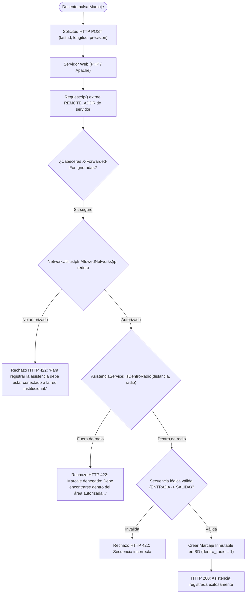

# Control de Red Institucional para Marcaje de Asistencia Docente

**Proyecto:** Sistema Web Integral — Escuela Oficial Rural Mixta Lo de Fuentes  
**Módulo:** Control de Asistencia Docente (Ajuste Final Posterior a Fase 16)  
**Requisitos Relacionados:** RF-19, RF-20, RF-21, RF-22, RNF-04, RNF-06  

---

## 1. Justificación y Propósito de Seguridad

El módulo de asistencia docente se concibió originalmente con validación perimetral por geolocalización basada en coordenadas GPS emitidas por el navegador (DT-49, DT-50). No obstante, los dispositivos móviles y navegadores permiten la simulación de coordenadas (GPS spoofing o herramientas de desarrollador), lo que podría permitir registrar asistencia fuera del recinto escolar.

Para blindar integralmente la integridad del marcaje, este ajuste introduce una **doble verificación perimetral obligatoria y simultánea**:
1. **Perímetro Físico (Geocerca):** Coordenadas geodésicas dentro del radio institucional oficial (fórmula Haversine calculada exclusivamente en el servidor backend).
2. **Perímetro Lógico (Red Institucional):** Solicitud HTTP originada forzosamente desde una subred autorizada del establecimiento escolar (por ejemplo, Wi-Fi institucional o segmento cableado escolar).

---

## 2. Arquitectura de Verificación de Red

---

## 3. Componentes Implementados

### 3.1. `App\Utils\NetworkUtil`
Clase estática encargada de la evaluación binaria de direcciones IP contra rangos CIDR:
- **IPv4:** Soporta máscaras arbitrarias `/0` a `/32` mediante máscaras a nivel de bits de 32 bits libres de desbordamiento por enteros con signo.
- **IPv6:** Soporta máscaras `/0` a `/128` mediante comparación de bytes y máscaras a nivel de bits en el byte límite (`inet_pton`).
- **Resiliencia:** Manejo seguro de cadenas vacías, CIDRs malformados y máscaras fuera de rango sin producir excepciones no controladas ni advertencias de PHP.

### 3.2. `App\Core\Request`
- Se incorporaron los métodos autoritativos `ip(): string` y `getClientIp(): string`.
- La dirección IP se deriva estrictamente de `$_SERVER['REMOTE_ADDR']`.
- **Inmunidad ante suplantación:** Se descartan de manera deliberada cabeceras manipulables por clientes como `X-Forwarded-For`, `X-Real-IP` o `Client-IP`, impidiendo que un docente remoto simule estar dentro de la red local inyectando cabeceras HTTP.
- Para entornos de pruebas automatizadas, `Request::create()` admite la inyección controlada del parámetro `$ip`.

### 3.3. Configuración del Entorno (`config/app.php`, `.env`, `.env.example`)
- Variable de entorno: `ATTENDANCE_ALLOWED_NETWORKS`.
- **Configurable por Entorno:** La lista de redes institucionales es completamente desacoplada y configurable según el ambiente de ejecución:
  - *Entorno Institucional Real:* Debe configurarse con el CIDR real de la red Wi-Fi/LAN autorizada de la escuela (por ejemplo `192.168.1.0/24` o la subred asignada por la administración del centro educativo).
  - *Desarrollo Local y Pruebas:* Se utiliza la interfaz loopback (`127.0.0.1/32,::1/128`) o subred de desarrollo para permitir la ejecución de suites automatizadas locales sin conexión a la red física de la escuela. Las direcciones loopback no constituyen la red institucional.
- **Política Fail-Closed:** Si la variable `ATTENDANCE_ALLOWED_NETWORKS` se encuentra vacía, no definida o contiene únicamente formatos inválidos, el sistema opera bajo la política de seguridad más restrictiva (fail-closed), denegando todo marcaje de asistencia hasta que se configure una red válida.

### 3.4. `App\Services\AsistenciaService`
- Validación en el flujo de `procesarMarcaje()` antes del cómputo geodésico y de la persistencia transaccional.
- Mensaje exacto ante IP no autorizada:
  > *"Para registrar la asistencia debe estar conectado a la red institucional."*
- Mensaje exacto ante geocerca fuera de radio:
  > *"Marcaje denegado: Debe encontrarse dentro del área autorizada para registrar la asistencia. Su ubicación actual se encuentra a X.XX metros de la institución, excediendo el radio autorizado de Y.YY metros."*
- Conserva la compatibilidad con todas las aserciones de regresión históricas (`excediendo el radio`).

---

## 4. Matriz de Decisiones Perimetrales

| Geocerca Válida (<= 100m) | Red Institucional Válida (CIDR) | Resultado de Marcaje | Código de Estado | Mensaje emitido |
|:---:|:---:|:---:|:---:|:---|
| **NO** | **NO** | Denegado | 422 | *"Para registrar la asistencia debe estar conectado a la red institucional."* |
| **SÍ** | **NO** | Denegado | 422 | *"Para registrar la asistencia debe estar conectado a la red institucional."* |
| **NO** | **SÍ** | Denegado | 422 | *"Marcaje denegado: Debe encontrarse dentro del área autorizada para registrar la asistencia..."* |
| **SÍ** | **SÍ** | **Autorizado** | **200** | *"Marcaje de ENTRADA/SALIDA registrado correctamente."* |

---

## 5. Verificación y Pruebas
La funcionalidad se encuentra validada mediante la suite `tests/run_tests_ajuste_final.php`, abarcando desde el cómputo binario de subredes hasta el rechazo HTTP real con token CSRF y sesiones autenticadas.
