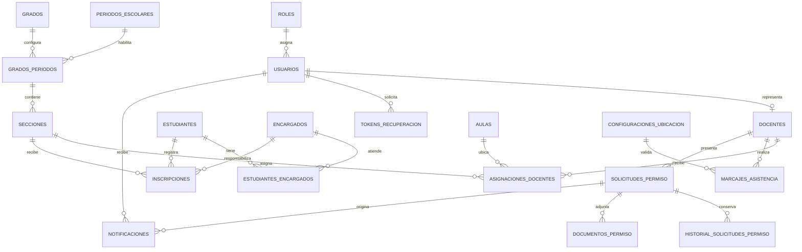

# Modelo conceptual de datos — Fase 1

## Propósito

El modelo soporta la autenticación de administración y docentes, la
configuración escolar por período, las inscripciones y cupos, las asignaciones
docentes, la asistencia con evidencia geográfica, los permisos, las
notificaciones y la recuperación futura de contraseña. No incorpora lógica PHP
ni entidades fuera del alcance aprobado.

## Entidades y justificación

| Tabla | Propósito | Origen | RF, RNF o regla relacionada |
|---|---|---|---|
| `roles` | Catalogar los roles que controlarán el acceso. | Alcance directo. | RF-02, RNF-03, RN-DOC-12, CA-DOC-10. |
| `usuarios` | Conservar identidad y credenciales de administración y docentes. | Alcance directo. | RF-01, RF-02, RF-03, RNF-03, RNF-04. |
| `docentes` | Extender al usuario con su identidad institucional docente y estado. | Alcance directo. | RF-15, RF-16, RF-17, RF-20 a RF-29. |
| `estudiantes` | Conservar los datos básicos mínimos del estudiante. | Alcance directo. | RF-04, RF-11, RF-30, RNF-04. |
| `encargados` | Conservar los datos mínimos del padre, madre o encargado, sin cuenta. | Alcance directo. | RF-05, RF-11, RF-14, RN-DOC-07. |
| `estudiantes_encargados` | Representar relaciones flexibles entre estudiantes y encargados. | Necesidad técnica indispensable. | RF-05, RNF-05. **CLASIFICACIÓN: ENTIDAD TÉCNICA.** |
| `periodos_escolares` | Separar configuraciones y operaciones por ciclo escolar. | Alcance directo. | RF-06, RNF-09, RN-DOC-05. |
| `grados` | Catalogar grados reutilizables entre períodos. | Alcance directo. | RF-06, RNF-09. |
| `grados_periodos` | Habilitar grados específicos dentro de un período. | Necesidad técnica indispensable. | RF-06, RN-DOC-05, CA-DOC-01. **CLASIFICACIÓN: ENTIDAD TÉCNICA.** |
| `secciones` | Configurar secciones y capacidad dentro de un grado y período. | Alcance directo. | RF-07 a RF-10, RF-32, RN-DOC-01 a RN-DOC-05. |
| `aulas` | Catalogar aulas configurables y desactivables. | Alcance directo. | RF-16, RNF-09, RN-DOC-14. |
| `asignaciones_docentes` | Relacionar docente, sección y aula conservando historial. | Alcance directo. | RF-16, RF-17, RF-31, RN-DOC-14, CA-DOC-04. |
| `inscripciones` | Relacionar estudiante, encargado responsable y sección con estado y código público. | Alcance directo. | RF-09 a RF-14, RF-30 a RF-32, RN-DOC-01 a RN-DOC-06. |
| `configuraciones_ubicacion` | Conservar coordenadas y radio configurables con vigencia histórica. | Alcance directo. | RF-18, RF-19, RNF-06, RNF-09. |
| `marcajes_asistencia` | Registrar cada entrada o salida y su validación geográfica. | Alcance directo. | RF-19 a RF-23, RF-29, RN-DOC-09 a RN-DOC-11. |
| `solicitudes_permiso` | Conservar la solicitud y su estado vigente. | Alcance directo. | RF-24, RF-27, RF-28, RN-DOC-13. |
| `historial_solicitudes_permiso` | Preservar cada cambio de estado, fecha y usuario decisor. | Necesidad técnica indispensable. | RF-27, RF-28, RNF-06, RN-DOC-13. **CLASIFICACIÓN: ENTIDAD TÉCNICA.** |
| `documentos_permiso` | Conservar metadatos de archivos asociados a permisos. | Alcance directo. | RF-25. |
| `notificaciones` | Persistir avisos internos sobre nuevas solicitudes de permiso. | Alcance directo limitado. | RF-26, CA-DOC-07, LIM-DOC-02. |
| `tokens_recuperacion` | Soportar recuperación futura mediante token hasheado, expiración y uso único. | Necesidad técnica indispensable. | RF-03, RNF-03. **CLASIFICACIÓN: ENTIDAD TÉCNICA.** |

No se crean tablas para comprobantes PDF ni reportes: ambos se generan a partir
de la información persistida. Tampoco se crea una auditoría general; la
trazabilidad exigida queda cubierta por marcajes, configuraciones de ubicación
e historial de permisos.

## Diagrama conceptual

## Cardinalidades principales

- Un rol corresponde a cero o muchos usuarios; cada usuario tiene un rol.
- Un usuario docente corresponde como máximo a un perfil docente; cada
  docente tiene exactamente un usuario.
- Estudiantes y encargados se relacionan muchos a muchos. La inscripción
  identifica al encargado responsable y exige que el vínculo exista.
- Un período habilita muchos grados y un grado puede habilitarse en muchos
  períodos. Cada combinación puede contener muchas secciones.
- Una sección puede conservar varias asignaciones históricas, pero solo una
  asignación activa; un docente puede atender varias secciones.
- Una sección recibe muchas inscripciones. El grado y el período se derivan de
  la sección para evitar duplicación.
- Cada marcaje pertenece a un docente y a la configuración geográfica utilizada.
- Cada solicitud pertenece a un docente y conserva muchos eventos de historial,
  documentos y notificaciones.

## Límites del modelo

El modelo no fija coordenadas, capacidades, nombres reales ni reglas de jornada.
La duplicidad de entrada/salida y el formato del código de confirmación quedan
para reglas de servicio posteriores porque el alcance no los define. La base sí
ofrece claves, estados e índices para implementarlos de forma segura.
