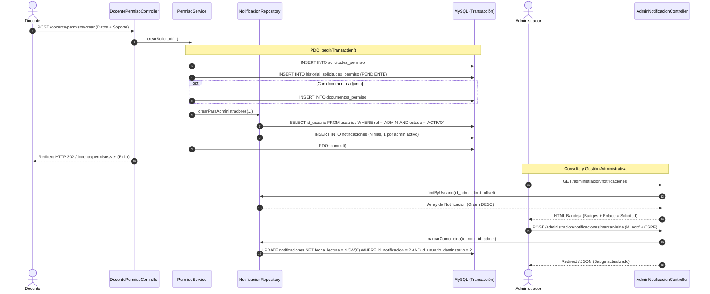

# ARQUITECTURA DEL MÓDULO DE NOTIFICACIONES — FASE 10
## SISTEMA WEB ESCUELA OFICIAL RURAL MIXTA LO DE FUENTES

**Módulo:** Notificaciones Administrativas (RF-26)  
**Autor:** Antigravity — Desarrollador Principal  
**Fecha:** 8 de octubre de 2026  
**Estado:** IMPLEMENTADO Y VALIDADO  

---

## 1. Alcance y Base Normativa

El presente módulo da cumplimiento exhaustivo al requerimiento funcional:
- **RF-26 — Notificación de permiso:**  
  *Texto literal del Documento Oficial de Alcance (Andersson Godoy):*  
  > *"La administración deberá recibir una notificación cuando exista una nueva solicitud."*

### Actores y Flujo de Comunicación:
- **Emisor:** Sistema (originado por la acción del Docente al enviar una solicitud de permiso laboral, RF-24).
- **Destinatarios:** Todos los usuarios activos con rol de administración institucional (`ADMINISTRACION` / `ADMINISTRADOR`).
- **Canal:** Base de datos relacional MySQL (tabla `notificaciones`), con interfaz web administrativa integrada (`views/admin/notificaciones/index.php`).

---

## 2. Diagrama de Flujo y Secuencia

---

## 3. Componentes de Arquitectura

### 3.1 Entidad `App\Models\Notificacion`
- Modelado orientado a objetos con propiedades `readonly` fuertemente tipadas:
  - `id_notificacion` (int)
  - `id_solicitud_permiso` (int)
  - `id_usuario_destinatario` (int)
  - `tipo` (string)
  - `titulo` (string)
  - `mensaje` (string)
  - `fecha_creacion` (string)
  - `fecha_lectura` (?string)
  - Atributos agregados mediante JOINs: `destinatario_nombre`, `destinatario_correo`, `docente_solicitante`.
- Métodos auxiliares: `isLeida(): bool`, `isPendiente(): bool`, `toArray(): array`.

### 3.2 Repositorio `App\Repositories\NotificacionRepository`
- Interfaz: `App\Repositories\NotificacionRepositoryInterface`.
- Métodos implementados:
  - `crearParaAdministradores(...)`: Resuelve los administradores activos e inserta una fila para cada uno dentro de la transacción activa.
  - `findByUsuario(int $idUsuario, int $limit, int $offset, ?string $estadoLectura)`: Devuelve el listado paginado y ordenado descendentemente por `fecha_creacion`.
  - `contarNoLeidasPorUsuario(int $idUsuario)`: Retorna la cantidad exacta de avisos pendientes (`fecha_lectura IS NULL`).
  - `marcarComoLeida(int $idNotificacion, int $idUsuario)`: Actualiza de forma atómica y aislada horizontalmente a `NOW(6)`.
  - `marcarTodasComoLeidas(int $idUsuario)`: Actualiza todas las notificaciones pendientes del usuario.
  - `findById(int $idNotificacion)`: Búsqueda individual por llave primaria.

### 3.3 Servicio `App\Services\NotificacionService`
- Orquesta las reglas de negocio entre controladores y repositorios.
- Aplica validaciones institucionales y asegura que las mutaciones respeten el aislamiento horizontal.

### 3.4 Controlador `App\Controllers\AdminNotificacionController`
- Endpoints implementados:
  - `GET /administracion/notificaciones`: Renderiza la vista principal con filtros por estado (`todas`, `no_leidas`, `leidas`).
  - `POST /administracion/notificaciones/marcar-leida`: Marca un aviso individual como leído.
  - `POST /administracion/notificaciones/marcar-todas`: Marca todos los avisos como leídos.
  - `GET /administracion/notificaciones/conteo`: Endpoint AJAX que devuelve `{ "success": true, "unread_count": N }`.

### 3.5 Vistas e Integración UI
- `views/admin/notificaciones/index.php`: Vista interactiva con pestañas de filtrado, diseño responsivo, badges de estado y botones de acción rápida.
- `views/layouts/main.php`: Enlace directo "🔔 Notificaciones" en la barra de navegación para administradores.
- `views/admin/index.php`: Tarjeta dedicada a notificaciones en el panel de control institucional.

---

## 4. Garantías de Seguridad y Robustez

1. **Aislamiento Horizontal (DT-66):** Ningún administrador puede consultar ni marcar como leídas las notificaciones dirigidas a otro usuario. El filtro `WHERE id_usuario_destinatario = ?` es forzado a nivel de consulta preparada SQL con el ID de la sesión autenticada.
2. **Atomicidad y Consistencia (DT-64):** La creación de la notificación se ejecuta dentro del mismo bloque transaccional que la solicitud. Si la solicitud revierte, no se emite ninguna notificación (cero huérfanas).
3. **Control de Acceso (RBAC):** Middleware `Authenticate` y `RequireRole('ADMINISTRADOR')` restringen el acceso a las rutas administrativas. Los docentes y usuarios anónimos son estrictamente rechazados (HTTP 403 / HTTP 302).
4. **Protección CSRF:** Todas las mutaciones POST requieren token de verificación anti-CSRF validado por `VerifyCsrfToken`.
5. **Prevención XSS:** Todos los datos dinámicos presentados en la vista son saneados mediante `e()` (`htmlspecialchars` con codificación UTF-8).
