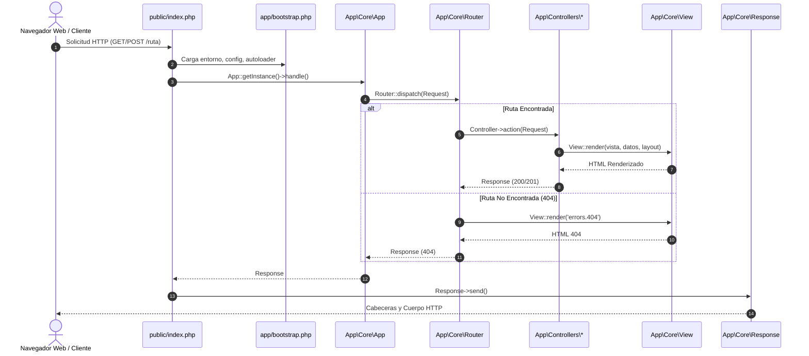

# Flujo de Solicitud HTTP — Fase 2

## Ciclo de vida de una solicitud

Toda interacción con la aplicación web sigue un flujo lineal y controlado que inicia en el Front Controller y finaliza en la emisión de la respuesta HTTP:

## Etapas del procesamiento

1. **Recepción:** El servidor web (Apache) redirige cualquier URI inexistente hacia `public/index.php` mediante `public/.htaccess`.
2. **Arranque (`bootstrap.php`):** Define constantes de directorios, registra el autocargador PSR-4, inicializa funciones helpers, lee `.env` y carga todos los archivos de configuración en memoria.
3. **Instanciación (`App.php`):** Obtiene la instancia singleton de la aplicación e inicializa el mapa de rutas del `Router`.
4. **Captura de Solicitud (`Request.php`):** Se crea un objeto `Request` normalizando el método HTTP, la URI solicitada, los parámetros de consulta (`$_GET`) y el cuerpo (`$_POST`).
5. **Enrutamiento (`Router.php`):** Se evalúa la coincidencia exacta de método y ruta:
   - Si coincide, se ejecuta el controlador asociado y su acción.
   - Si no coincide, se activa el manejador 404 retornando la vista controlada.
6. **Manejo de Errores y Excepciones:** Si ocurre un fallo de base de datos (`DatabaseException`), `App` lo intercepta y emite un código 503 con vista segura. Ante cualquier otro error no previsto (`Throwable`), se emite un error 500 y se escribe en `storage/logs/app.log`.
7. **Emisión de Respuesta (`Response.php`):** Se envían las cabeceras HTTP (`Content-Type`, `Status`) y se transmite el contenido renderizado hacia el cliente.
