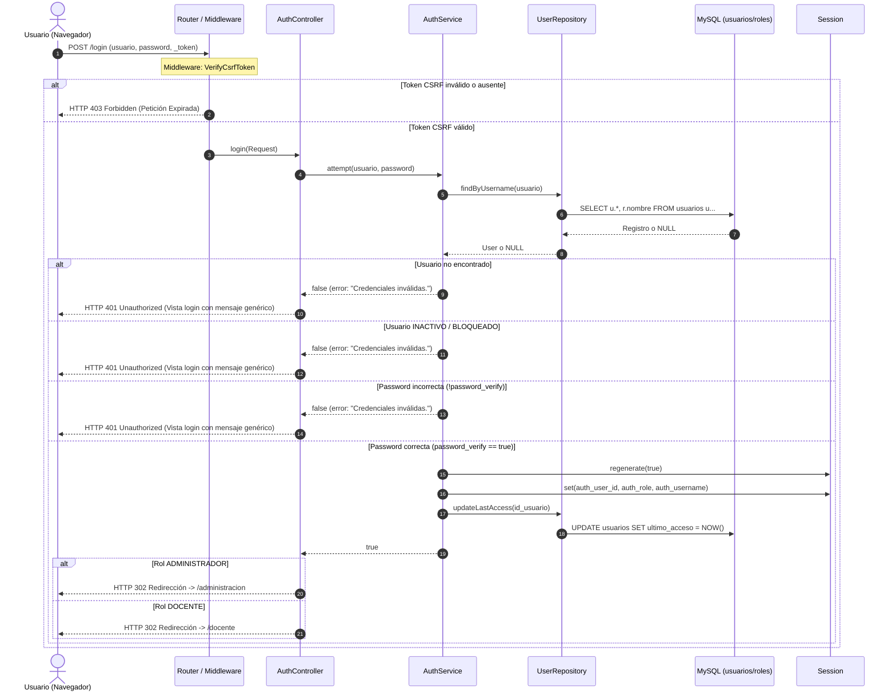
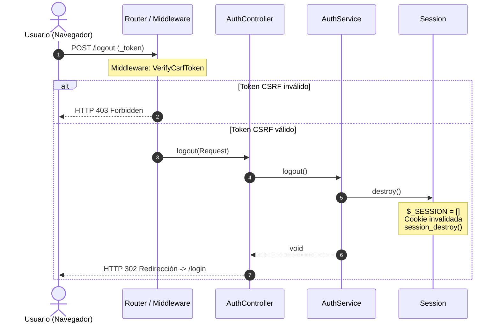

# Flujo de Inicio y Cierre de Sesión (Login / Logout)

## 1. Flujo de Inicio de Sesión (`POST /login`)



---

## 2. Flujo de Cierre de Sesión (`POST /logout`)



---

## 3. Principios de Seguridad Aplicados en el Flujo

1. **Mensaje de Error Genérico:**  
   Tanto si el usuario no existe, como si la contraseña no coincide o si la cuenta está inactiva, la respuesta emitida es invariablemente:
   ```text
   Credenciales inválidas.
   ```
   Esto previene ataques de enumeración de usuarios.

2. **Protección contra Fuerza Bruta:**  
   Se documenta que las contraseñas utilizan BCrypt con costo computacional nativo, mitigando ataques de fuerza bruta offline o de diccionario. El rate limiting formal queda reservado para la Fase 14.

3. **Cero Fuga de Contraseñas y Hashes:**  
   En ninguna circunstancia se imprime o registra en logs la contraseña en texto claro ni el hash BCrypt. Los registros en `storage/logs/app.log` solo reportan el nombre de usuario y el resultado de la operación.
