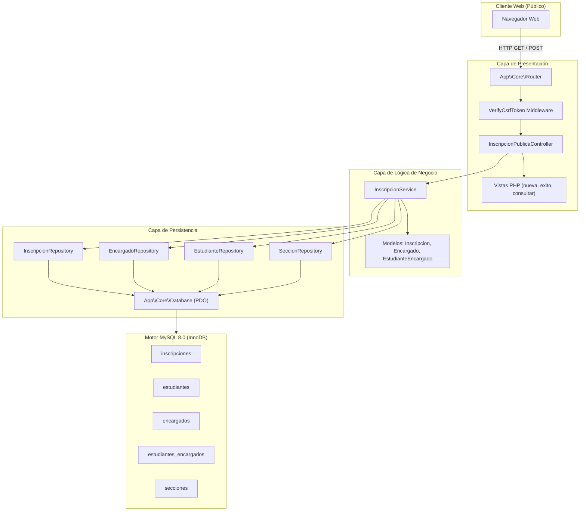
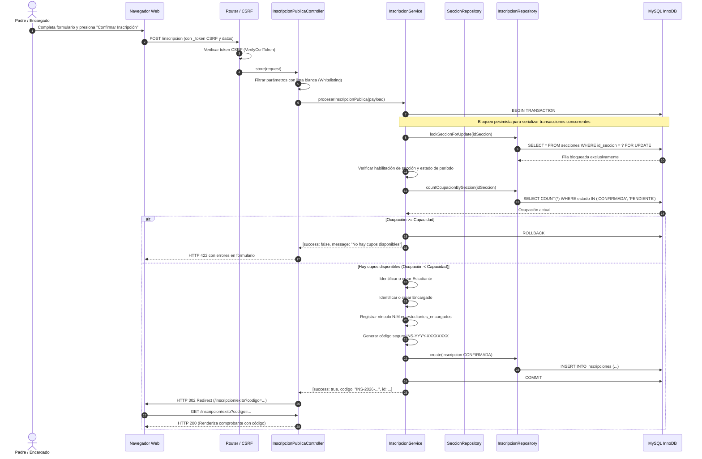
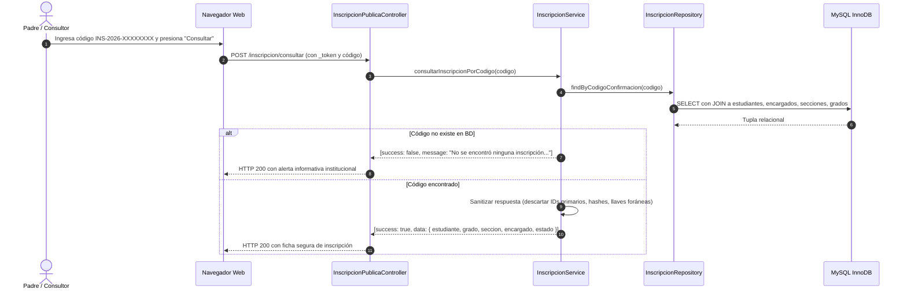

# Arquitectura del Módulo de Inscripciones y Cupos — Fase 6

**Proyecto:** Sistema Web para la Escuela Oficial Rural Mixta Lo de Fuentes  
**Fase:** Fase 6 — Inscripciones y Cupos  
**Fecha:** Septiembre 2026  

---

## 1. Visión General de la Arquitectura

El módulo de **Inscripciones y Cupos** proporciona a la comunidad escolar (especialmente a padres, madres y tutores legales) una interfaz pública accesible en línea para solicitar la matrícula de estudiantes sin requerir autenticación previa.

La arquitectura sigue el patrón establecido en las fases previas del proyecto: **Controller → Service → Repository → PDO / MySQL InnoDB**, garantizando una estricta separación de responsabilidades, alta comprobabilidad y apego a las directivas de seguridad web.

---

## 2. Componentes de la Arquitectura

### 2.1 Modelos de Dominio (`app/Models/`)

1. **`Inscripcion.php`**:
   - Entidad inmutable con propiedades `readonly` tipadas estrictamente.
   - Representa el registro de matrícula en `inscripciones` (`id_inscripcion`, `id_estudiante`, `id_encargado`, `id_seccion`, `codigo_confirmacion`, `estado`, `fecha_inscripcion`, `fecha_confirmacion`).
   - Incluye campos informativos calculados a partir de los `JOIN` relacionales (`estudiante_nombres`, `estudiante_apellidos`, `codigo_estudiante`, `encargado_nombres`, `encargado_apellidos`, `parentesco`, `seccion_codigo`, `seccion_nombre`, `grado_nombre`, `periodo_nombre`).
   - Métodos auxiliares de conveniencia: `isConfirmada()`, `isPendiente()`, `getEstudianteNombreCompleto()`, `getEncargadoNombreCompleto()`.

2. **`Encargado.php`**:
   - Representa al tutor legal registrado en la tabla `encargados`.
   - Propiedades: `id_encargado`, `nombres`, `apellidos`, `telefono`, `correo`, `fecha_creacion`, `fecha_actualizacion`.
   - Métodos auxiliares: `getNombreCompleto()`, `toArray()`, `fromArray()`.

3. **`EstudianteEncargado.php`**:
   - Representa la relación asociativa N:M en `estudiantes_encargados`.
   - Propiedades: `id_estudiante_encargado`, `id_estudiante`, `id_encargado`, `parentesco`, `es_principal`.
   - Métodos auxiliares: `isPrincipal()`, `toArray()`, `fromArray()`.

---

### 2.2 Repositorios de Persistencia (`app/Repositories/`)

1. **`InscripcionRepositoryInterface.php` y `InscripcionRepository.php`**:
   - `findById(int $id): ?Inscripcion`: Consulta un registro por llave primaria con `JOIN` a todas las entidades vinculadas.
   - `findByCodigoConfirmacion(string $codigo): ?Inscripcion`: Búsqueda exacta por código único institucional.
   - `findVigenteByEstudianteAndSeccion(int $idEstudiante, int $idSeccion): ?Inscripcion`: Detección de matrículas activas previas.
   - `countOcupacionBySeccion(int $idSeccion): int`: Conteo de inscripciones vigentes (`CONFIRMADA` o `PENDIENTE`).
   - `lockSeccionForUpdate(int $idSeccion): ?array`: Adquisición de bloqueo exclusivo a nivel de fila (`SELECT ... FOR UPDATE`) en InnoDB.
   - `create(array $data): int`: Inserción controlada que omite estrictamente las columnas generadas almacenadas `estudiante_vigente` y `seccion_vigente`.
   - `existsCodigo(string $codigo): bool`: Verificación rápida de colisión para el generador aleatorio.
   - `findAll(int $limit, int $offset): array`: Listado paginado para auditoría.

2. **`EncargadoRepositoryInterface.php` y `EncargadoRepository.php`**:
   - `findById(int $id): ?Encargado`: Búsqueda por ID.
   - `findMatching(string $nombres, string $apellidos): ?Encargado`: Reutilización de encargados existentes.
   - `create(array $data): int`: Registro de nuevos encargados.
   - `linkEstudiante(int $idEstudiante, int $idEncargado, string $parentesco, bool $esPrincipal): int`: Registro del vínculo formal en `estudiantes_encargados`.
   - `hasVinculo(int $idEstudiante, int $idEncargado): bool`: Comprobación de existencia del vínculo.
   - `findVinculo(int $idEstudiante, int $idEncargado): ?EstudianteEncargado`: Consulta del vínculo con detalles de parentesco.

---

### 2.3 Capa de Servicio (`app/Services/InscripcionService.php`)

El servicio orquesta la lógica de negocio y las reglas de validación académica:

- **`obtenerPeriodoInscripcion()`**: Localiza el ciclo lectivo con estado `'ACTIVO'` o `'PLANIFICADO'` que no se encuentre cerrado.
- **`obtenerGradosHabilitados(int $idPeriodo)`**: Consulta únicamente los grados con `grados_periodos.habilitado = 1`.
- **`obtenerSeccionesDisponibles(int $idGradoPeriodo, bool $soloDisponibles)`**: Calcula para cada sección habilitada su ocupación actual (`COUNT(*)`) y sus cupos restantes (`capacidad - ocupacion`). Filtra secciones llenas cuando se invoca para el formulario público (RN-DOC-02).
- **`generarCodigoConfirmacion(string $prefijo)`**: Genera códigos no secuenciales `INS-YYYY-XXXXXXXX` con entropía criptográfica fuerte y bucle de reintento.
- **`procesarInscripcionPublica(array $input)`**: Orquestador indivisible de matrícula ejecutado bajo transacción ACID con aislamiento y bloqueo pesimista.
- **`consultarInscripcionPorCodigo(string $codigo)`**: Consulta saneada que proyecta exclusivamente datos seguros sin exponer claves primarias.

---

### 2.4 Controlador Público (`app/Controllers/InscripcionPublicaController.php`)

Controlador sin requerimiento de autenticación expuesto en Internet:

- **`createForm(Request $request): Response`**: Renderiza el formulario público de inscripción con el ciclo escolar vigente y los grados habilitados.
- **`getSeccionesDisponibles(Request $request): Response`**: Endpoint API JSON que alimenta dinámicamente el selector de secciones vía JavaScript según el grado seleccionado, excluyendo secciones sin cupos disponibles.
- **`store(Request $request): Response`**: Procesa la solicitud `POST`. Aplica lista blanca de atributos (*whitelisting*), invoca al servicio y aplica el patrón Post/Redirect/Get (PRG) redirigiendo a la pantalla de éxito con `HTTP 302`.
- **`success(Request $request): Response`**: Muestra la constancia digital con el código de confirmación obtenido.
- **`consultarForm(Request $request): Response`**: Renderiza la interfaz de búsqueda por código.
- **`consultar(Request $request): Response`**: Procesa la consulta del comprobante y muestra la ficha con los datos del estudiante inscrito.

---

## 3. Diagrama de Secuencia: Inscripción Pública y Control de Cupos

---

## 4. Diagrama de Secuencia: Consulta Pública por Código

