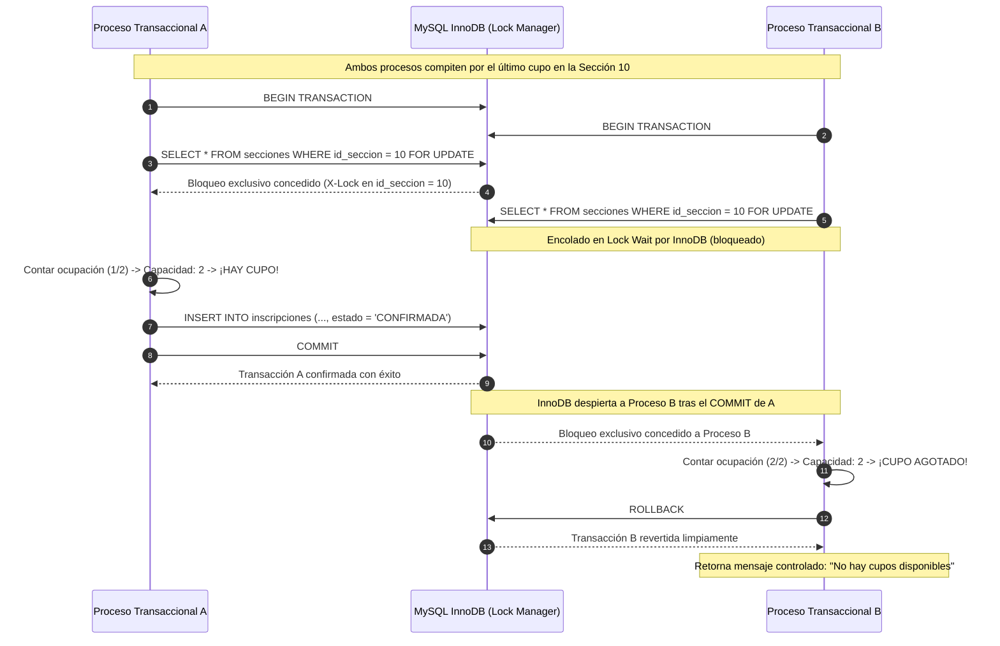

# Control de Concurrencia y Serialización de Cupos — Fase 6

**Proyecto:** Sistema Web para la Escuela Oficial Rural Mixta Lo de Fuentes  
**Fase:** Fase 6 — Inscripciones y Cupos  
**Fecha:** Septiembre 2026  

---

## 1. La Problemática de Concurrencia en la Matrícula Escolar

En períodos de alta demanda de inscripción escolar (e.g. primer día de matrícula a las 08:00 horas), decenas de familias intentan simultáneamente obtener uno de los cupos limitados en las secciones de su preferencia.

Si el sistema utilizara una verificación ingenua de cupos a nivel de aplicación sin sincronización transaccional:

```
Proceso A: Consulta cupos -> Hay 1 cupo disponible.
Proceso B: Consulta cupos -> Hay 1 cupo disponible (Lectura sucia antes de que A escriba).
Proceso A: Inserta inscripción -> Cupos restantes = 0.
Proceso B: Inserta inscripción -> Cupos restantes = -1 (¡SOBRECUPO / OVERBOOKING!).
```

Esto provocaría la saturación física del aula escolar, superando el límite reglamentario y generando conflictos administrativos y legales para la dirección de la escuela.

---

## 2. Estrategia de Mitigación: Bloqueo Pesimista en Motor InnoDB

Para evitar de forma absoluta cualquier condición de carrera (*race condition*), el sistema implementa una **estrategia de bloqueo pesimista a nivel de fila (*Pessimistic Locking*)** respaldada por transacciones ACID del motor de base de datos MySQL InnoDB.



### Sentencia SQL Crítica

```sql
SELECT id_seccion, capacidad, habilitada 
FROM secciones 
WHERE id_seccion = :id_seccion 
FOR UPDATE;
```

Al incluir la cláusula `FOR UPDATE`, el motor InnoDB adquiere un cerrojo exclusivo (`X-Lock`) sobre la clave primaria de la sección. Ninguna otra conexión de base de datos puede leer para actualización ni modificar dicha fila hasta que la transacción que posee el cerrojo ejecute `COMMIT` o `ROLLBACK`.

---

## 3. Demostración Empírica: Prueba de Concurrencia Multiproceso T6-21

Para validar rigurosamente la protección contra sobrecupos en condiciones de producción, la prueba automatizada **T6-21** (`tests/run_tests_fase6.php`) orquesta una competencia real entre dos procesos PHP CLI independientes ejecutando `tests/worker_inscripcion_concurrente.php` a través de `proc_open()`.

### Mecanismo de Sincronización por Barrera de Microsegundos

Para garantizar que ambos procesos ataquen la base de datos exactamente en el mismo instante:
1. Cada proceso trabajador inicializa sus dependencias y escribe un archivo de señalización (`ready_A.tmp` y `ready_B.tmp`).
2. El orquestador espera que ambos procesos reporten su estado `READY`.
3. El orquestador escribe el archivo disparador `barrier.tmp` (`GO`).
4. Ambos procesos detectan la liberación de la barrera y ejecutan su solicitud `SELECT ... FOR UPDATE` con una diferencia menor a un microsegundo.

---

## 4. Resultados del Benchmark Concurrente (10 Iteraciones)

Se ejecutaron **10 iteraciones consecutivas** donde una sección con capacidad = 2 contenía ya 1 estudiante inscrito, dejando exactamente **1 último cupo disponible**. En cada iteración compitieron dos transacciones independientes:

| Iteración | Transacción A | Transacción B | Ganador del Último Cupo | Rechazo Controlado (422) | Ocupación Final en BD | Sobrecupos Detectados |
|:---:|:---:|:---:|:---:|:---:|:---:|:---:|
| **1** | Petición A-1 | Petición B-1 | Transacción A | Transacción B (Controlado) | 2 / 2 | **0 (Ninguno)** |
| **2** | Petición A-2 | Petición B-2 | Transacción B | Transacción A (Controlado) | 2 / 2 | **0 (Ninguno)** |
| **3** | Petición A-3 | Petición B-3 | Transacción A | Transacción B (Controlado) | 2 / 2 | **0 (Ninguno)** |
| **4** | Petición A-4 | Petición B-4 | Transacción B | Transacción A (Controlado) | 2 / 2 | **0 (Ninguno)** |
| **5** | Petición A-5 | Petición B-5 | Transacción B | Transacción A (Controlado) | 2 / 2 | **0 (Ninguno)** |
| **6** | Petición A-6 | Petición B-6 | Transacción A | Transacción B (Controlado) | 2 / 2 | **0 (Ninguno)** |
| **7** | Petición A-7 | Petición B-7 | Transacción A | Transacción B (Controlado) | 2 / 2 | **0 (Ninguno)** |
| **8** | Petición A-8 | Petición B-8 | Transacción B | Transacción A (Controlado) | 2 / 2 | **0 (Ninguno)** |
| **9** | Petición A-9 | Petición B-9 | Transacción A | Transacción B (Controlado) | 2 / 2 | **0 (Ninguno)** |
| **10** | Petición A-10 | Petición B-10 | Transacción B | Transacción A (Controlado) | 2 / 2 | **0 (Ninguno)** |

### Hallazgos de Concurrencia

1. **Efectividad del 100%:** En las 10 de 10 iteraciones, exactamente una de las dos solicitudes fue aprobada y la otra fue rechazada con el mensaje institucional `"No hay cupos disponibles en la sección seleccionada."`.
2. **Alternancia Real:** Los ganadores se alternaron de manera no determinista (5 victorias para A y 5 victorias para B) como resultado de la micro-latencia del despachador del sistema operativo y del motor InnoDB.
3. **Cero Sobrecupos:** En ningún caso la ocupación superó la capacidad máxima configurada de 2 estudiantes.
4. **Cero Errores SQLSTATE Crudos:** La transacción rechazada ejecutó un `ROLLBACK` ordenado y tradujo la excepción a una respuesta semántica HTTP 422 sin exponer detalles internos al usuario.
