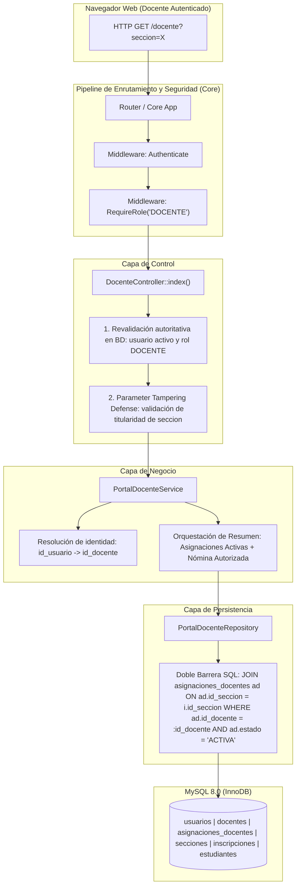

# ARQUITECTURA DEL PORTAL DOCENTE — FASE 7

**Proyecto:** Sistema Web para la Escuela Oficial Rural Mixta Lo de Fuentes  
**Fase Autorizada:** Fase 7 — Portal Docente  
**Rol:** ANTIGRAVITY — DESARROLLADOR PRINCIPAL  
**Requisitos Satisfechos:** RF-17 (Listado de estudiantes por sección asignada), RF-31 (Integración con inscripciones), RNF-04 (Privacidad parcial de datos de estudiantes)

---

## 1. INTRODUCCIÓN Y ALCANCE

El Portal Docente constituye el entorno operativo institucional mediante el cual los profesores titulares de la Escuela Oficial Rural Mixta Lo de Fuentes acceden de forma segura, privada y autorizada a su información académica, a sus asignaciones de grado y sección vigentes, y a la nómina oficial de estudiantes legalmente matriculados en sus aulas.

En esta Fase 7 se consolidó la transición desde el controlador provisional de Fase 3 hacia un módulo de nivel de producción bajo el patrón de arquitectura limpia institucional (**Controller $\to$ Service $\to$ Repository $\to$ PDO/MySQL**), implementando defensas exhaustivas de control de acceso, aislamiento horizontal y minimización de datos.

---

## 2. DIAGRAMA ARQUITECTÓNICO



---

## 3. COMPONENTES DEL SUBSISTEMA

### 3.1. `DocenteController` (`app/Controllers/DocenteController.php`)
- **Punto de Entrada Institucional:** Expone la acción `index(Request $request): Response` vinculada a la ruta privada `GET /docente`.
- **Defensa en Profundidad:** Revalida en tiempo real que el usuario en sesión permanezca con rol `DOCENTE` y estado `ACTIVO` consultando la base de datos (previniendo sesiones obsoletas o privilegios revocados).
- **Protección contra Parameter Tampering:** Si el usuario incluye parámetros como `?seccion=123` o `?id_seccion=123`, verifica explícitamente mediante el servicio si dicha sección pertenece a las asignaciones activas del docente autenticado. Cualquier discrepancia o intento de acceso a secciones ajenas culmina de inmediato en un **HTTP 403 Forbidden**.
- **Inmunidad ante Inyecciones de Identidad:** Ignora de forma absoluta cualquier parámetro `id_docente` enviado por GET o POST. La identidad docente se resuelve única y exclusivamente a partir del identificador de usuario almacenado en la sesión segura del servidor.

### 3.2. `PortalDocenteService` (`app/Services/PortalDocenteService.php`)
- **Orquestación de Lógica de Negocio:** Centraliza las operaciones requeridas para el portal:
  1. `obtenerDocentePorUsuarioId(int $usuarioId): ?Docente`
  2. `obtenerAsignacionesActivas(int $idDocente): array`
  3. `isSeccionAsignadaADocente(int $idDocente, int $idSeccion): bool`
  4. `obtenerEstudiantesSeccion(int $idDocente, int $idSeccion): array`
  5. `obtenerResumenPortal(int $idDocente, ?int $idSeccionSolicitada): array`
- **Gestión de Casos de Borde:** Detecta proactivamente docentes sin asignación vigente devolviendo una estructura controlada (`sin_asignacion => true`) con un mensaje cortés y amigable, evitando excepciones o pantallas en blanco.
- **Soporte Multiasignación:** Si un docente tiene más de una sección activa, selecciona ordenadamente la primera por defecto y permite alternar a la sección solicitada mediante validación previa de titularidad.

### 3.3. `PortalDocenteRepository` (`app/Repositories/PortalDocenteRepository.php`)
- **Interfaz y Contrato:** Implementa `PortalDocenteRepositoryInterface` aislando las consultas directas en SQL con `PDO` y sentencias preparadas.
- **Doble Barrera a Nivel Relacional:** En la consulta de estudiantes (`findEstudiantesBySeccionDocente`), la sentencia SQL vincula obligatoriamente el `id_seccion` con la tabla `asignaciones_docentes` verificando que `ad.id_docente = :id_docente` y `ad.estado = 'ACTIVA'`:
  ```sql
  SELECT e.id_estudiante, e.codigo_estudiante, e.nombres, e.apellidos, e.fecha_nacimiento,
         i.codigo_confirmacion, i.fecha_confirmacion, i.estado AS inscripcion_estado
  FROM inscripciones i
  JOIN estudiantes e ON e.id_estudiante = i.id_estudiante
  JOIN asignaciones_docentes ad ON ad.id_seccion = i.id_seccion
  WHERE i.id_seccion = :id_seccion
    AND ad.id_docente = :id_docente
    AND ad.estado = 'ACTIVA'
    AND i.estado = 'CONFIRMADA'
    AND e.estado = 'ACTIVO'
  ORDER BY e.apellidos ASC, e.nombres ASC;
  ```
  Esta consulta garantiza que, aun si existiera una falla lógica en capas superiores, el motor de base de datos retornará estrictamente 0 registros si el docente no es titular activo de dicha sección.

### 3.4. Vista Institucional (`views/docente/index.php`)
- **Diseño Ergonómico y Accesible:** Presenta de manera ordenada y legible el perfil del docente (nombre completo, código docente, usuario, correo, estado), el selector de secciones activas (cuando aplique), la tarjeta de contexto académico (grado, sección, aula física asignada, capacidad) y la nómina oficial de estudiantes (RF-17).
- **Protección XSS en Renderizado:** Todas las variables dinámicas se escapan mediante la función `e()` (`htmlspecialchars`), neutralizando vectores de inyección en nombres de estudiantes o campos de texto libre.
- **Minimización de Datos (RNF-04):** No expone llaves primarias internas, registros de encargados, CUI, teléfonos, direcciones, hashes de contraseñas ni identificadores ajenos a la actividad pedagógica del docente.

---

## 4. INTEGRACIÓN CON FASES PREVIAS

1. **Fase 3 (Autenticación y Roles):** Aprovecha la sesión segura, regeneración contra session fixation y el middleware `RequireRole('DOCENTE')`. Se preserva la retrocompatibilidad con la prueba T3-09 mediante la presencia institucional de la insignia `Portal docente — sesión válida`.
2. **Fase 5 (Asignaciones Docentes):** Consume directamente la tabla `asignaciones_docentes` y respeta la integridad de la regla física `uk_asignaciones_seccion_activa`. Las asignaciones con estado `INACTIVA` se filtran automáticamente y quedan archivadas fuera del portal docente activo.
3. **Fase 6 (Inscripciones y Cupos — RF-31):** Al confirmarse una inscripción en el módulo público, el registro se asocia directamente a la sección mediante la clave `id_seccion`. Al consultar el portal docente, la nómina refleja inmediatamente al nuevo estudiante en tiempo real sin requerir tareas cron, duplicaciones redundantes ni copias manuales.
