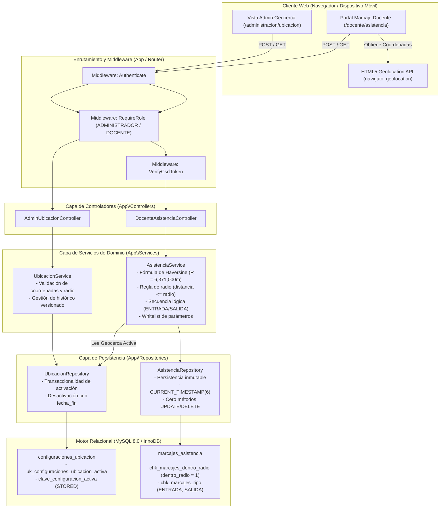

# ARQUITECTURA DEL MÓDULO DE ASISTENCIA Y GEOLOCALIZACIÓN — FASE 8

**Proyecto:** Sistema Web para la Escuela Oficial Rural Mixta Lo de Fuentes  
**Fase:** Fase 8 — Asistencia Docente y Geolocalización  
**Rol:** ANTIGRAVITY — DESARROLLADOR PRINCIPAL  
**Requisitos cubiertos:** RF-18, RF-19, RF-20, RF-21, RF-22, RF-23, RNF-06  

---

## 1. Visión General del Módulo

El módulo de **Asistencia Docente y Geolocalización** proporciona a la institución educativa un mecanismo seguro, confiable y auditable para el control del registro de jornada laboral de los docentes mediante validación geográfica en tiempo real.

El diseño sigue una **arquitectura por capas desacoplada** (Clean Architecture / MVC modular), garantizando:
1. **Defensa en profundidad:** Ninguna regla de negocio depende de la integridad del cliente o del navegador.
2. **Autoridad absoluta del backend:** Tanto el cálculo de distancias como la marca temporal de auditoría se computan exclusivamente en el servidor.
3. **Inmutabilidad de datos:** Los registros de asistencia son inalterables una vez persistidos.
4. **Aislamiento horizontal estricto:** Los docentes solo pueden visualizar su propio historial cronológico.

---

## 2. Diagrama de Arquitectura de Capas

---

## 3. Componentes de la Arquitectura

### 3.1 Modelos de Entidad (`app/Models/`)
- [`ConfiguracionUbicacion.php`](file:///c:/Users/David/Documents/Universidad/2026/Segundo%20semestre/seminario%20de%20tecnologias/ProyectoFinal/app/Models/ConfiguracionUbicacion.php): Modela los parámetros de la geocerca institucional (coordenadas centrales, radio en metros, vigencia, usuario creador y estado de activación).
- [`MarcajeAsistencia.php`](file:///c:/Users/David/Documents/Universidad/2026/Segundo%20semestre/seminario%20de%20tecnologias/ProyectoFinal/app/Models/MarcajeAsistencia.php): Modela los registros inmutables de marcaje de entrada y salida, distancia calculada y precisión del dispositivo.

### 3.2 Contratos e Interfaces (`app/Repositories/`)
- [`UbicacionRepositoryInterface.php`](file:///c:/Users/David/Documents/Universidad/2026/Segundo%20semestre/seminario%20de%20tecnologias/ProyectoFinal/app/Repositories/UbicacionRepositoryInterface.php): Define las operaciones de consulta y reemplazo transaccional de geocercas activas.
- [`AsistenciaRepositoryInterface.php`](file:///c:/Users/David/Documents/Universidad/2026/Segundo%20semestre/seminario%20de%20tecnologias/ProyectoFinal/app/Repositories/AsistenciaRepositoryInterface.php): Define exclusivamente operaciones de inserción y lectura cronológica, careciendo deliberadamente de métodos de modificación o eliminación (`update`, `delete`).

### 3.3 Implementación de Repositorios (`app/Repositories/`)
- [`UbicacionRepository.php`](file:///c:/Users/David/Documents/Universidad/2026/Segundo%20semestre/seminario%20de%20tecnologias/ProyectoFinal/app/Repositories/UbicacionRepository.php): Encapsula la transacción atómica que desactiva la configuración previa (registrando `fecha_fin = CURRENT_TIMESTAMP(6)`) e inserta la nueva versión activa.
- [`AsistenciaRepository.php`](file:///c:/Users/David/Documents/Universidad/2026/Segundo%20semestre/seminario%20de%20tecnologias/ProyectoFinal/app/Repositories/AsistenciaRepository.php): Persiste marcajes utilizando sentencias preparadas y `CURRENT_TIMESTAMP(6)` directo del motor SQL. Asegura aislamiento horizontal mediante cláusulas `WHERE id_docente = :d`.

### 3.4 Lógica de Negocio (`app/Services/`)
- [`UbicacionService.php`](file:///c:/Users/David/Documents/Universidad/2026/Segundo%20semestre/seminario%20de%20tecnologias/ProyectoFinal/app/Services/UbicacionService.php): Valida rigurosamente los límites geográficos ($\text{latitud} \in [-90, 90]$, $\text{longitud} \in [-180, 180]$, $\text{radio} > 0$, descripción no vacía $\le 150$ caracteres).
- [`AsistenciaService.php`](file:///c:/Users/David/Documents/Universidad/2026/Segundo%20semestre/seminario%20de%20tecnologias/ProyectoFinal/app/Services/AsistenciaService.php): Orquesta la verificación de estado docente activo, el cálculo de distancia geodésica mediante Haversine, la validación de frontera de radio, la verificación de secuencia lógica y la persistencia de marcajes.

### 3.5 Controladores (`app/Controllers/`)
- [`AdminUbicacionController.php`](file:///c:/Users/David/Documents/Universidad/2026/Segundo%20semestre/seminario%20de%20tecnologias/ProyectoFinal/app/Controllers/AdminUbicacionController.php): Provee al administrador las acciones para auditar el histórico y configurar una nueva geocerca.
- [`DocenteAsistenciaController.php`](file:///c:/Users/David/Documents/Universidad/2026/Segundo%20semestre/seminario%20de%20tecnologias/ProyectoFinal/app/Controllers/DocenteAsistenciaController.php): Resuelve la identidad del docente desde la sesión autenticada, aplica whitelist contra mass-assignment y procesa solicitudes tanto tradicionales como asíncronas (JSON / AJAX).

### 3.6 Vistas de Usuario (`views/`)
- `views/admin/ubicacion/index.php`: Panel de visualización de geocerca activa y tabla de auditoría de versiones históricas.
- `views/admin/ubicacion/configurar.php`: Formulario de configuración con campos validados y tokens CSRF.
- `views/docente/asistencia/index.php`: Interfaz docente para captura de coordenadas mediante `navigator.geolocation` y visualización de historial inmutable.
