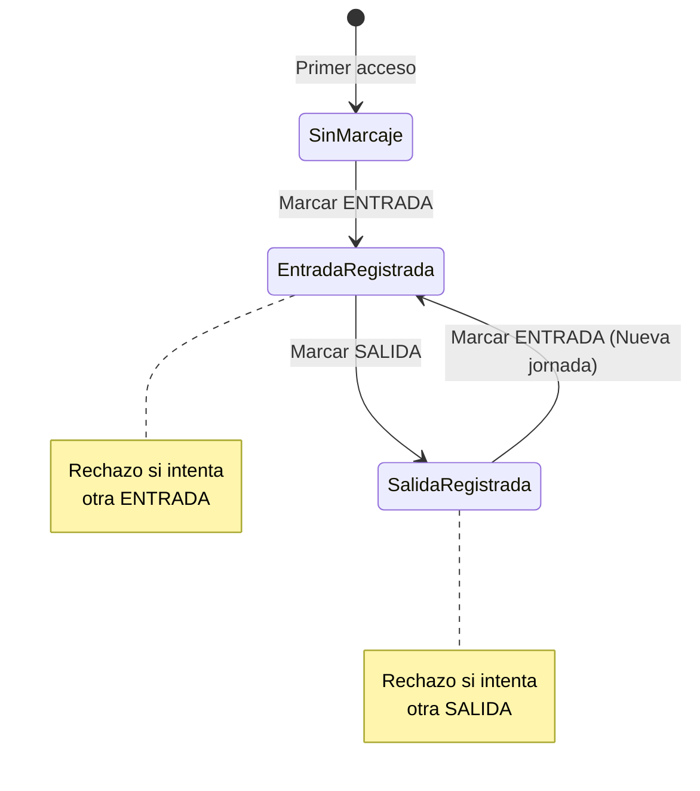

# REGLAS DE NEGOCIO PARA MARCAJES DE ASISTENCIA — FASE 8

**Proyecto:** Sistema Web para la Escuela Oficial Rural Mixta Lo de Fuentes  
**Fase:** Fase 8 — Asistencia Docente y Geolocalización  
**Rol:** ANTIGRAVITY — DESARROLLADOR PRINCIPAL  
**Requisitos cubiertos:** RF-20, RF-21, RF-22, RF-23, RNF-06  

---

## 1. Secuencia Lógica Obligatoria de Marcajes

Para mantener la coherencia cronológica y evitar duplicidades operativas, el servicio `AsistenciaService` implementa una máquina de estados finitos que valida el último marcaje registrado por el docente:



### Reglas Específicas:
1. **Marcaje de ENTRADA (`tipo = 'ENTRADA'`):**
   - El docente no debe poseer un marcaje previo de tipo `ENTRADA` sin su respectiva `SALIDA`.
   - Si el último marcaje del docente fue `ENTRADA`, se rechaza con error:  
     *“Secuencia inválida: Ya cuenta con un marcaje de entrada registrado pendiente de salida.”*
2. **Marcaje de SALIDA (`tipo = 'SALIDA'`):**
   - El docente debe contar obligatoriamente con un marcaje previo de `ENTRADA`.
   - Si el docente nunca ha marcado o su último marcaje ya fue `SALIDA`, se rechaza con error:  
     *“Secuencia inválida: No puede registrar una salida sin haber registrado previamente una entrada.”*

---

## 2. Marca Temporal Autoritativa de Servidor (DT-51, RF-22)

> [!IMPORTANT]
> El campo `fecha_hora` de la tabla `marcajes_asistencia` se genera **exclusivamente mediante `CURRENT_TIMESTAMP(6)` en el motor de base de datos MySQL**.  
> Ni el reloj del teléfono móvil del docente ni los encabezados HTTP del cliente son tomados en cuenta para la marca temporal. Esto previene cualquier manipulación horaria mediante cambio de fecha/hora en el dispositivo del usuario.

La precisión con 6 dígitos de microsegundos (`DATETIME(6)`) garantiza unicidad y estricto orden cronológico para auditoría legal.

---

## 3. Inmutabilidad Absoluta de Registros (DT-52, RNF-06)

1. **Restricción a Nivel de Repositorio:**  
   La interfaz `AsistenciaRepositoryInterface` carece por diseño de los métodos `update`, `actualizarMarcaje`, `delete` o `eliminarMarcaje`.
2. **Restricción a Nivel de Base de Datos:**  
   La tabla `marcajes_asistencia` implementa:
   ```sql
   CONSTRAINT chk_marcajes_dentro_radio CHECK (dentro_radio = 1)
   ```
   Cualquier intento de almacenar un marcaje con `dentro_radio = 0` arroja una violación de restricción física (`IntegrityConstraintViolation`), impidiendo estados incongruentes.
3. **Auditoría Forense:**  
   Cada marcaje conserva de forma perenne: `id_docente`, `id_usuario`, `id_configuracion_ubicacion`, `fecha_hora`, `tipo`, `latitud_dispositivo`, `longitud_dispositivo`, `precision_metros`, `distancia_metros` y `dentro_radio`.

---

## 4. Consulta de Historial Personal y Aislamiento Horizontal (DT-54, RF-23)

- El docente solo puede consultar sus propios registros mediante la ruta `/docente/asistencia/historial` o el panel principal `/docente/asistencia`.
- La consulta SQL en `AsistenciaRepository::findMarcajesByDocente` filtra estrictamente por `m.id_docente = :d` y ordena descendentemente por `m.fecha_hora DESC`.
- No existe ningún parámetro en la URL o cuerpo POST que permita cambiar el `id_docente` consultado.
