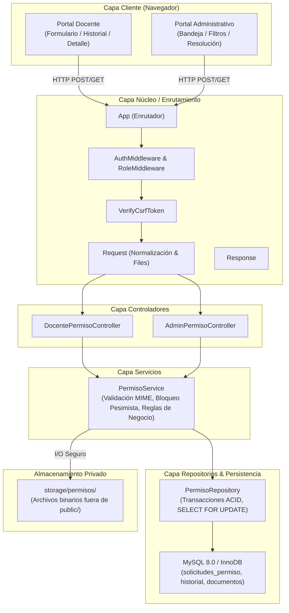

# ARQUITECTURA DEL SISTEMA DE PERMISOS DOCENTES — FASE 9

**Proyecto:** Sistema Web para la Escuela Oficial Rural Mixta Lo de Fuentes  
**Fase:** Fase 9 — Gestión de Permisos Docentes  
**Rol:** ANTIGRAVITY — DESARROLLADOR PRINCIPAL  

---

## 1. Visión General de la Arquitectura

El módulo de Gestión de Permisos Docentes implementa los requisitos oficiales **RF-24**, **RF-25**, **RF-27**, **RF-28** y **RNF-06**, estructurándose bajo el patrón arquitectónico por capas del sistema (MVC + Repositorio + Servicio) con estricto desacoplamiento y alta cohesión.

---

## 2. Componentes y Responsabilidades

### 2.1 Modelos de Dominio
- **`SolicitudPermiso`** (`app/Models/SolicitudPermiso.php`): Entidad que representa la solicitud formal con sus estados canónicos (`PENDIENTE`, `APROBADO`, `RECHAZADO`), datos del docente, fechas y metadatos.
- **`HistorialSolicitudPermiso`** (`app/Models/HistorialSolicitudPermiso.php`): Entidad inmutable que registra cada evento de transición de estado, el usuario autor (`id_usuario_actor`) y el comentario explicativo.
- **`DocumentoPermiso`** (`app/Models/DocumentoPermiso.php`): Metadatos del archivo de soporte adjunto (nombre original, ruta hasheada en disco, tipo MIME real verificado y tamaño en bytes).

### 2.2 Repositorio de Persistencia
- **`PermisoRepositoryInterface`** (`app/Repositories/PermisoRepositoryInterface.php`): Contrato de acceso a datos para solicitudes, historial y documentos.
- **`PermisoRepository`** (`app/Repositories/PermisoRepository.php`): Implementación PDO con transacciones transaccionales, consultas parametrizadas, ordenamiento cronológico descendente y bloqueo pesimista `findForUpdate()`.

### 2.3 Capa de Servicio de Negocio
- **`PermisoService`** (`app/Services/PermisoService.php`):
  1. Validación de reglas de negocio (fechas, motivos, longitudes).
  2. Validación de archivos multipart: verificación MIME real mediante `finfo`, detección de ejecutables o PHP camuflados, control estricto de cuota (máximo 5MB).
  3. Almacenamiento seguro en disco desacoplado del nombre original del cliente.
  4. Resolución atómica de estados con bloqueo concurrente `SELECT ... FOR UPDATE`.
  5. Registro obligatorio e inmutable del historial de auditoría.

### 2.4 Controladores Web
- **`DocentePermisoController`** (`app/Controllers/DocentePermisoController.php`):
  - `index()`: Historial personal del docente autenticado.
  - `createForm()`: Renderizado del formulario seguro con token CSRF.
  - `store()`: Procesamiento de solicitud y archivo adjunto.
  - `show()`: Consulta detallada de una solicitud propia con historial.
  - `descargarDocumento()`: Descarga segura autorizada mediante streaming de headers.
- **`AdminPermisoController`** (`app/Controllers/AdminPermisoController.php`):
  - `index()`: Bandeja general administrativa con filtros combinados por estado y docente.
  - `show()`: Visualización completa de solicitud, documento e historial.
  - `aprobar()` / `rechazar()`: Endpoints transaccionales de resolución.
  - `descargarDocumento()`: Streaming de documentos de cualquier solicitud para auditoría.

---

## 3. Delimitación Estricta con la Fase 10

Conforme a las instrucciones obligatorias:
- **RF-26 (Notificación de permiso):** Corresponde de manera estricta y exclusiva a la **Fase 10 (Notificaciones Internas)**.
- La tabla física `notificaciones` existe desde la Fase 1 en la base de datos, pero en la Fase 9 **no se crea ninguna fila ni se genera acoplamiento funcional**, manteniéndose `RF-26` en estado `PENDIENTE — FASE 10`.
