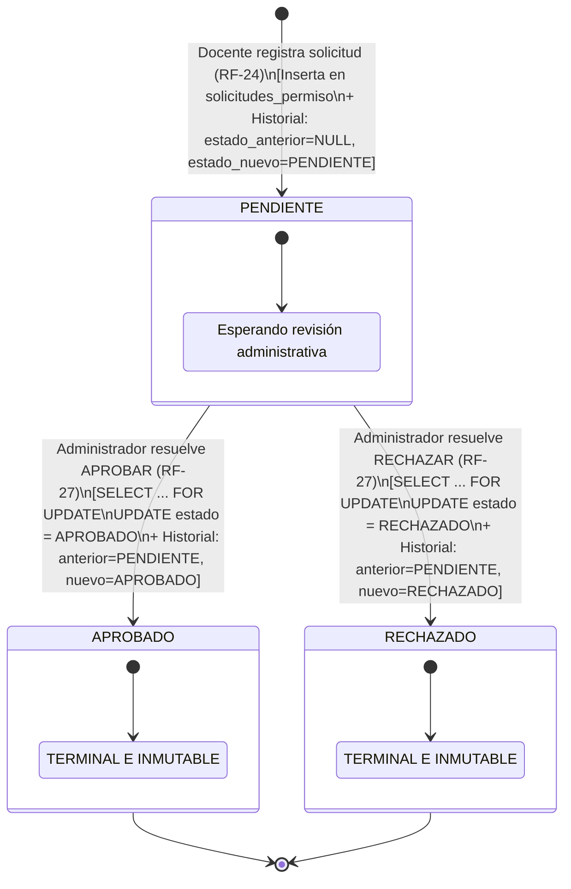

# FLUJO Y MÁQUINA DE ESTADOS DE PERMISOS DOCENTES — FASE 9

**Proyecto:** Sistema Web para la Escuela Oficial Rural Mixta Lo de Fuentes  
**Fase:** Fase 9 — Gestión de Permisos Docentes  
**Rol:** ANTIGRAVITY — DESARROLLADOR PRINCIPAL  

---

## 1. Definición de Estados Canónicos

El ciclo de vida de una solicitud de permiso docente se rige por un conjunto formal y finito de tres estados canónicos, respaldados a nivel de base de datos por la restricción física `chk_solicitudes_estado CHECK (estado IN ('PENDIENTE', 'APROBADO', 'RECHAZADO'))`:

| Estado | Tipo | Descripción | Actor que Origina |
| :--- | :---: | :--- | :--- |
| **`PENDIENTE`** | Inicial / Transitorio | La solicitud ha sido registrada formalmente por el docente y se encuentra en espera de resolución directiva. | Docente Propietario (`RF-24`) |
| **`APROBADO`** | Terminal / Inmutable | La solicitud ha sido autorizada formalmente por la administración escolar. No admite modificaciones posteriores. | Administrador (`RF-27`) |
| **`RECHAZADO`** | Terminal / Inmutable | La solicitud ha sido denegada por la administración escolar. No admite modificaciones posteriores. | Administrador (`RF-27`) |

---

## 2. Diagrama de Transición de Estados



---

## 3. Matriz de Transiciones Permitidas y Prohibidas

| Estado Actual | Transición Intentada | Resultado | Justificación Técnica y Regla de Negocio |
| :---: | :---: | :---: | :--- |
| *(Nuevo registro)* | $\to$ `PENDIENTE` | **PERMITIDO** | Estado inicial obligatorio (`DT-56`). |
| *(Nuevo registro)* | $\to$ `APROBADO` | **BLOQUEADO** | Protección contra asignación masiva. Toda solicitud nace en `PENDIENTE`. |
| *(Nuevo registro)* | $\to$ `RECHAZADO` | **BLOQUEADO** | Toda solicitud debe iniciar en `PENDIENTE`. |
| `PENDIENTE` | $\to$ `APROBADO` | **PERMITIDO** | Resolución administrativa autorizada (`RF-27`). Requiere rol `ADMINISTRACION`. |
| `PENDIENTE` | $\to$ `RECHAZADO` | **PERMITIDO** | Resolución administrativa autorizada (`RF-27`). Requiere rol `ADMINISTRACION`. |
| `PENDIENTE` | $\to$ `PENDIENTE` | **BLOQUEADO** | Prohibido por constraint `chk_historial_transicion` (`estado_anterior <> estado_nuevo`). |
| `APROBADO` | $\to$ `RECHAZADO` | **BLOQUEADO** | Estado terminal inmutable. Excepción `DomainException: La solicitud ya fue resuelta`. |
| `APROBADO` | $\to$ `PENDIENTE` | **BLOQUEADO** | Estado terminal inmutable. Regresión de estado prohibida. |
| `RECHAZADO` | $\to$ `APROBADO` | **BLOQUEADO** | Estado terminal inmutable. Excepción `DomainException: La solicitud ya fue resuelta`. |
| `RECHAZADO` | $\to$ `PENDIENTE` | **BLOQUEADO** | Estado terminal inmutable. Regresión de estado prohibida. |

---

## 4. Control de Concurrencia y Bloqueo Pesimista (DT-62)

Para garantizar la integridad ante posibles condiciones de carrera (por ejemplo, múltiples administradores resolviendo la misma solicitud simultáneamente o doble clic en el formulario de aprobación), el servicio `PermisoService` ejecuta la resolución dentro de una transacción ACID estricta utilizando bloqueo pesimista a nivel de fila:

```sql
SELECT * FROM solicitudes_permiso WHERE id_solicitud_permiso = :id FOR UPDATE;
```

### Protocolo de Resolución Atómica:
1. `beginTransaction()`
2. `findForUpdate($id)`: Adquiere lock exclusivo en MySQL sobre la tupla.
3. Verificación de invariante de estado:
   ```php
   if (!$solicitud->isPendiente()) {
       $this->permisoRepo->rollBack();
       throw new DomainException('La solicitud ya se encuentra resuelta (' . $solicitud->estado . ').');
   }
   ```
4. Actualización del estado en `solicitudes_permiso`:
   ```sql
   UPDATE solicitudes_permiso SET estado = :estado, fecha_actualizacion = CURRENT_TIMESTAMP(6) WHERE id_solicitud_permiso = :id;
   ```
5. Inserción obligatoria e inmutable en `historial_solicitudes_permiso`:
   ```sql
   INSERT INTO historial_solicitudes_permiso (id_solicitud_permiso, id_usuario_actor, estado_anterior, estado_nuevo, comentario, fecha_cambio)
   VALUES (:sol, :actor, 'PENDIENTE', :nuevo, :comentario, CURRENT_TIMESTAMP(6));
   ```
6. `commit()`: Libera el lock pesimista y consolida la persistencia.

---

## 5. Aislamiento de Roles y Control de Acceso

1. **Docente:**
   - Puede crear solicitudes exclusivamente para sí mismo (`id_docente` obtenido de la sesión autenticada).
   - No tiene acceso a endpoints de resolución (`/administracion/permisos/{id}/aprobar` y `rechazar` devuelven HTTP 403 Forbidden).
   - Solo puede visualizar sus propias solicitudes (aislamiento horizontal estricto).

2. **Administrador:**
   - Acceso global a la bandeja de solicitudes de todos los docentes.
   - Autoridad exclusiva para ejecutar transiciones `PENDIENTE -> APROBADO` o `PENDIENTE -> RECHAZADO`.
